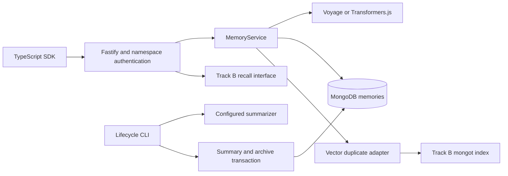

# Engram · Neha's Track A

A TypeScript memory write and lifecycle service backed by MongoDB. This implementation covers A1–A7, the P4 embedding provider, P5 CI, and a write benchmark harness. The SDK is prepared for packaging; npm publication and the demo video are not performed.

## Stack

pnpm workspaces, TypeScript, MongoDB's official Node.js driver, Fastify, Zod, Vitest, ESLint, and Prettier. Embeddings use Voyage AI or Transformers.js. Local embeddings use `Xenova/all-MiniLM-L6-v2` with 384 dimensions. Voyage defaults to `voyage-4-lite` with 1024 dimensions.

## Run locally

The Docker database uses host port 27018 to coexist with a local MongoDB service. Override it with `MONGODB_PORT` and update `MONGODB_URI` to match.

Install Node.js 22+ and pnpm 11.25.0. Use a MongoDB replica set. The isolated development/test Compose file targets MongoDB Community 9.0.4; Tanisha's shared mongot Compose setup can replace it later.

```sh
pnpm install
cp .env.example .env
docker compose -f docker-compose.test.yml up -d --wait
pnpm build
pnpm db:init
pnpm dev
```

Set `API_KEYS` in `.env` to a JSON object mapping namespaces to distinct random keys of at least 32 characters. Generate a key with `node -e "console.log(require('node:crypto').randomBytes(32).toString('hex'))"`. The API listens on `127.0.0.1:3000`. OpenAPI documentation is at `/docs`, and the schema is at `/docs/json`.

The local model downloads on its first use. For offline operation, provision its ONNX and tokenizer files beforehand, set `LOCAL_MODEL_PATH` to their parent directory, and set `LOCAL_OFFLINE=true`. First-time model loading can be slow. No LLM is needed for normal memory writes.

For Voyage, set `EMBEDDING_PROVIDER=voyage`, `VOYAGE_API_KEY`, and `EMBEDDING_DIMENSIONS=1024`. A database is bound to one model and dimension count; switching providers requires a separate database or an explicit re-embedding migration. Padding incompatible vectors is not supported.

```sh
curl http://localhost:3000/remember \
  -H 'Content-Type: application/json' \
  -H 'x-api-key: YOUR_API_KEY' \
  -d '{"namespace":"support-bot","userId":"u_123","content":"Prefers answers in Python","type":"preference"}'

curl 'http://localhost:3000/memories?namespace=support-bot&userId=u_123&limit=25' \
  -H 'x-api-key: YOUR_API_KEY'
```

## Track A behavior

| Feature | Implementation                                                                                                                     |
| ------- | ---------------------------------------------------------------------------------------------------------------------------------- |
| A1      | Strict collection `$jsonSchema`, tenant/user/status listing indexes, type listing index, TTL and active exact-duplicate uniqueness |
| A2      | Validated `remember()`, embedding validation, rule-based tags and importance, optional source and expiry                           |
| A3      | Exact deduplication plus configurable `$vectorSearch` adapter; semantic threshold defaults to 0.92                                 |
| A4      | TTL expiry, scoped `forget()`, elapsed-time exponential importance decay, scheduled decay in the API process                       |
| A5      | Daily episode grouping, configurable LLM summarizer, summary creation and original archival in one transaction                     |
| A6      | Fastify `/remember`, `/recall`, `/forget`, `/memories`, namespace API keys, Zod validation, OpenAPI                                |
| A7      | Typed standalone SDK with timeouts, cancellation and bounded retries for reads                                                     |

`remember()` refreshes the content, embedding, importance, expiry and source of a duplicate and merges its tags. It preserves its ID, creation time and access history. Type is part of duplicate identity. Concurrent identical writes are protected by a partial unique index. Semantic near-duplicates can still race before search indexing catches up; semantic uniqueness is not guaranteed.

MongoDB TTL cleanup is asynchronous. Listing and deduplication exclude expired memories before physical deletion. `forget({namespace, userId})` deletes active and archived memories. API keys authorize a whole namespace; an application must enforce its own end-user authorization before calling Engram.

The public contract is in `packages/core/src/types.ts`. Storage adds `contentHash` for exact deduplication and `decayAt` for idempotent elapsed-time decay. These fields are stripped from public responses. Coordinate changes to the shared public contract with Tanisha.

## Track B connection points

The repository does not implement recall, search-index provisioning, MCP, the dashboard or the demo agent. `/recall` returns HTTP 501 until a `Recall` function is passed to `buildApp({service, apiKeys, recall})` in the server entry point. The write-path tests are not the M1 remember/recall acceptance test.

Set `DEDUP_MODE=vector` after mongot and B1's vector index are ready. The index must use `embedding`, cosine similarity, the configured dimension count, and filter fields `namespace`, `userId`, `status`, and `type`. Its name defaults to `memories_vector`. The threshold is a MongoDB vectorSearchScore, not raw cosine similarity. Search errors return HTTP 503 rather than silently disabling deduplication. `DEDUP_MODE=exact` is the explicit default for developing Track A independently.

## Lifecycle

The API runs decay every `DECAY_INTERVAL_MS`, with a default importance half-life of 90 days. Manual runs:

```sh
pnpm lifecycle decay
pnpm lifecycle consolidate support-bot 7
```

For consolidation, configure `SUMMARIZER_URL` as a complete OpenAI-compatible chat-completions endpoint, `SUMMARIZER_MODEL`, and optionally `SUMMARIZER_API_KEY`. This supports a locally hosted model or a hosted provider. Episodes are sent to that configured endpoint.

Consolidation groups each user's old active episodes by UTC day, processes up to 20 episodes per group and 100 groups per run, and requires at least two episodes. It generates the summary before starting a transaction, then rechecks the originals before writing. Deletion or edits during generation cause that group to be skipped. Failures during archival roll back the summary. A summary inherits the earliest finite source expiry so consolidation does not extend retention. Schedule the CLI externally if automatic consolidation is desired; inspect its output for failures.

## Verification

```sh
pnpm format:check
pnpm lint
pnpm typecheck
pnpm build
pnpm test
pnpm test:integration
```

Integration tests start an isolated temporary replica set using a locally installed `mongod`. Set `MONGOD_BINARY` if it is not on PATH. Alternatively set `MONGODB_TEST_URI` to a running replica set. Each test run uses and removes its own uniquely named database. GitHub Actions uses the MongoDB 9.0.4 Compose replica set on each pull request.

To run against the Docker database:

```sh
MONGODB_TEST_URI='mongodb://127.0.0.1:27018/?replicaSet=rs0&directConnection=true' pnpm test:integration
```

All 12 integration tests passed against the Docker MongoDB 9.0.4 replica set on October 25, 2026.

Tests cover concurrent identical writes, schema rejection, expiry filtering, pagination, elapsed-time decay, namespace boundaries, API validation, transaction rollback, and deletion during summarization. External embedding and LLM APIs are mocked in tests. The actual mongot search path and downloaded local model require separate environment checks.

## Write benchmarks

```sh
pnpm bench:write 100
BENCH_VECTOR=true pnpm bench:write 100
```

The benchmark warms the provider and reports writes/second and p50/p95 latency including embedding latency. The optional vector run measures the additional search cost against an existing B1 index. It uses a separate temporary namespace and removes its own data afterward. Results are workload-specific; no benchmark numbers are claimed before running it. Retrieval quality and retrieval latency belong to Track B.



Provider references: [Voyage embeddings](https://docs.voyageai.com/docs/embeddings), [Transformers.js pipelines](https://huggingface.co/docs/transformers.js/en/pipelines), and [MongoDB transactions](https://www.mongodb.com/docs/drivers/node/v6.x/crud/transactions/).
