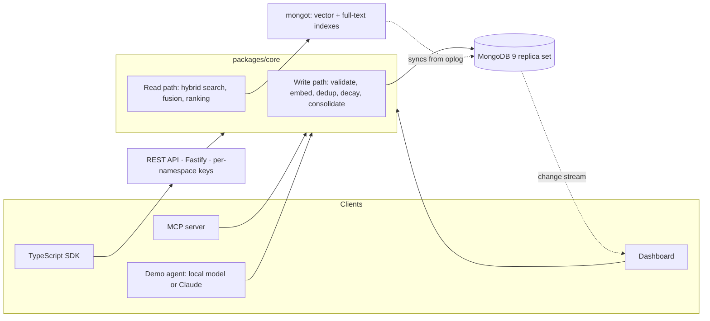

# Engram

Long-term memory for AI agents, built on MongoDB Community Server and MongoDB Search (`mongot`).

AI assistants forget everything when a conversation ends. With Engram, an agent saves what it learns ("prefers Python", "allergic to peanuts", "the deploy failed because of the Helm chart") and later recalls the memories that matter for the task at hand. You can use it from any agent through a REST API, a TypeScript SDK, or MCP (Claude Desktop, Claude Code and other MCP clients), and watch it work in a live dashboard.

Built by **Tanisha** (Track B: search, ranking, MCP, dashboard) and **Neha** (Track A: write path, lifecycle, REST API, SDK).

**Everything runs free, on your own machine.** The database and search engine run in Docker. The embedding model (25 MB) and the chat model behind the demo agent and consolidation (SmolLM2-360M, 365 MB) run on your CPU inside Node through Transformers.js. No accounts, API keys or GPU. Claude and Voyage AI are optional upgrades if you have keys.

## Quick start

Requires Node 22 (`nvm use`), pnpm 10 and Docker. On Windows with WSL, turn on WSL integration in Docker Desktop (Settings → Resources → WSL integration).

```bash
pnpm install
cp .env.example .env    # then set API_KEYS (see the comment in the file)
pnpm db:up              # MongoDB 9 replica set + mongot
pnpm build
pnpm db:init            # collection, schema, indexes and search indexes
pnpm db:seed            # 16 sample memories for demo-agent / u_demo
```

Then any of:

```bash
pnpm dev:dashboard      # live dashboard on http://localhost:4317
pnpm dev:api            # REST API on http://localhost:3000, docs at /docs
```

Try the demo agent, which runs on the free local model (downloads ~365 MB the first time):

```bash
pnpm demo --script      # remembering you across two separate conversations
pnpm demo               # chat with it yourself
```

The first run also downloads the embedding model (`Xenova/all-MiniLM-L6-v2`, about 25 MB). Both models are cached, so later runs work offline. If port 27017 is taken (for example by a MongoDB installed on Windows), set `MONGODB_PORT=27018` and the same port in `MONGODB_URI` in `.env`.

## How it fits together



| Path                            | What                                                                                                                   | Owner                      |
| ------------------------------- | ---------------------------------------------------------------------------------------------------------------------- | -------------------------- |
| `packages/core`                 | The engine. `src/write/` saves and maintains memories, `src/read/` finds and ranks them, `src/engram.ts` joins the two | write: Neha, read: Tanisha |
| `packages/server`               | REST API: `/remember`, `/recall`, `/forget`, `/memories`, OpenAPI docs at `/docs`                                      | Neha                       |
| `packages/sdk`                  | Typed client with timeouts, cancellation and retries for reads                                                         | Neha                       |
| `packages/mcp`                  | MCP server with `recall_memories`, `remember`, `forget_memory`                                                         | Tanisha                    |
| `apps/dashboard`                | Stats, explained search results, live change-stream feed, delete                                                       | Tanisha                    |
| `apps/demo`                     | Chat agent that remembers you between conversations: a free local model by default, Claude optional                    | both                       |
| `bench`                         | Write and recall benchmarks                                                                                            | both                       |
| `docker/`, `docker-compose.yml` | Local MongoDB + mongot                                                                                                 | Tanisha                    |

## The memory document

```ts
{
  _id, namespace: "support-bot", userId: "u_123",
  type: "fact" | "preference" | "episode" | "summary",
  content: "Prefers answers in Python",
  embedding: number[],            // never returned to callers
  tags, importance /* 0..1 */, accessCount, lastAccessedAt, createdAt,
  expiresAt,                      // TTL index deletes it after this
  status: "active" | "archived",  // archived = merged into a summary
  source: { sessionId, messageId }, consolidatedInto,
  contentHash, decayAt            // storage-only, never returned
}
```

The full contract is in [packages/core/src/types.ts](packages/core/src/types.ts). Both tracks build against it.

## Saving memories (Track A)

- **Schema validation (A1).** A strict `$jsonSchema` validator checks every write, including vector length. The collection is bound to one embedding model, so mixing vector sizes fails loudly. Compound indexes back listing by user, status, type and date. A TTL index expires memories.
- **`remember()` (A2).** Validates input with Zod, embeds the content, derives tags and an importance score when the caller doesn't give them, and stores the memory.
- **Duplicates (A3).** Identical text is caught by a partial unique index on a content hash, which stays correct even with concurrent writes. Near-duplicates (`DEDUP_MODE=vector`) are found with `$vectorSearch` on the same index recall uses. The existing memory is updated, merging tags and keeping its id and access history.
- **Forgetting (A4).** TTL expiry, `forget()` for one memory or everything about a user, and importance decay with a 90-day half-life. Decay is based on elapsed time and never applied twice.
- **Consolidation (A5).** `pnpm lifecycle consolidate <namespace>` groups each user's old episodes by day, summarizes them with any OpenAI-compatible endpoint (by default the free local chat model), then inserts the summary and archives the originals in one multi-document transaction. If an episode changes or is deleted while the summary is being written, that group is skipped. If archiving fails, the summary insert rolls back.
- **API and SDK (A6, A7).** Fastify with per-namespace API keys (compared as hashes in constant time), Zod validation and OpenAPI docs. The SDK retries reads with backoff and never retries writes.

## Finding memories (Track B)

1. **Search two indexes in parallel.** `$vectorSearch` finds memories with similar meaning. `$search` (Lucene, English stemming) finds keyword matches. Both pre-filter inside the index to one user's active memories, so other users' data is never scored.
2. **Fuse the two lists.** The default is relative score fusion, the same method as MongoDB's `$scoreFusion`: each list's scores are scaled to 0–1 and averaged. Rank fusion (RRF, in the app or with MongoDB's `$rankFusion`) is also available. The benchmark below explains the default.
3. **Rank** with `0.6 × relevance + 0.2 × importance + 0.2 × recency`, where recency halves every 30 days a memory goes unused (after Park et al., _Generative Agents_, 2023). Every result carries these signals, so you can see why it ranked where it did.
4. **Record use.** One `updateMany` bumps `accessCount` and `lastAccessedAt` on the returned memories.

The dashboard streams changes with a **change stream**. Each event's resume token is sent as the server-sent event id, so a browser that reconnects picks up exactly where it left off.

## Benchmarks

Measured on October 25, 2026 on a laptop (WSL2), MongoDB 9.0.4 + mongot 1.70.5, `Xenova/all-MiniLM-L6-v2` (384 dims). Reproduce with `pnpm bench:recall 5000` and `BENCH_VECTOR=true pnpm bench:write 200`.

**Recall quality and latency.** 24 questions, each with one right answer, over 5,016 memories: 16 real ones plus 300 distractors for the same user and 4,700 for other users. Hit@1 means the right memory came first.

| Method                             | Hit@1   | Hit@3   | MRR      | Hit@1, keyword questions | Hit@1, paraphrased questions | p50     | p95     |
| ---------------------------------- | ------- | ------- | -------- | ------------------------ | ---------------------------- | ------- | ------- |
| Keywords only (`$search`)          | 63%     | 67%     | 0.64     | 100%                     | 44%                          | 11.0 ms | 16.7 ms |
| Meaning only (`$vectorSearch`)     | 92%     | 96%     | 0.94     | 100%                     | 88%                          | 23.6 ms | 42.0 ms |
| Hybrid, rank fusion (RRF, in app)  | 83%     | 83%     | 0.86     | 100%                     | 75%                          | 23.3 ms | 41.1 ms |
| Hybrid, `$rankFusion` (in MongoDB) | 83%     | 83%     | 0.86     | 100%                     | 75%                          | 28.7 ms | 36.8 ms |
| **Hybrid, score fusion (default)** | **92%** | **96%** | **0.94** | **100%**                 | **88%**                      | 18.4 ms | 23.9 ms |

What this showed:

- **Rank fusion lost to meaning search alone.** RRF only looks at positions. When meaning search finds one clearly best match (0.67 similarity against 0.56 for the next), RRF treats it as one step ahead, and importance and recency can then push a worse memory above it. Score fusion keeps the size of the gap, so it matches meaning search on paraphrased questions and keeps keyword search's 100% on exact names like "Ledgerly". We switched the default because of this table.
- **Keyword search alone can't answer paraphrases** ("what food should I avoid" doesn't share a word with "Allergic to peanuts").
- **"Why did the release break this week" fails everywhere.** The small local model doesn't connect "release" with "deploy". A larger model (`EMBEDDING_PROVIDER=voyage`) is the next thing to measure.

| Vector search over 5,016 memories             | p50     | p95     |
| --------------------------------------------- | ------- | ------- |
| Approximate (HNSW graph, `numCandidates` 300) | 13.2 ms | 20.2 ms |
| Exact (scans every vector, `exact: true`)     | 10.9 ms | 14.7 ms |

At this size, scanning every vector is still faster than walking the HNSW graph. Approximate search pays off at larger collections.

**Writes,** including embedding time:

| Duplicate check                          | Writes/second | p50     | p95     |
| ---------------------------------------- | ------------- | ------- | ------- |
| Exact text only                          | 56.9          | 16.9 ms | 22.2 ms |
| Exact + near-duplicate (`$vectorSearch`) | 39.4          | 24.7 ms | 30.9 ms |

## The demo agent

`pnpm demo --script` plays two conversations with no shared chat history. In the first you mention a few things about yourself. In the second, the agent uses them: it writes code in Go, warns about the shellfish allergy, and recalls yesterday's deploy failure.

Each turn, the agent:

1. recalls the 3 memories most related to your message (hybrid search),
2. hands them to the model as "Notes about me" in front of your message,
3. replies, then saves each statement you made as its own memory (questions are skipped).

To watch it live, start the dashboard and open http://localhost:4317/?user=u_video, then run `pnpm demo --script --user u_video`. Each memory appears in the dashboard's feed as it's saved and recalled.

That design is deliberate. A 360M-parameter model can't reliably decide when to call tools, so the code does the memory work and the model only writes the reply. Expect small-model answers: short on nuance and sometimes inventing details. With `DEMO_LLM=claude` and an API key, the agent instead uses Claude with tool calling, deciding for itself what to recall and remember.

## Use with Claude Desktop

See [packages/mcp/README.md](packages/mcp/README.md). Each MCP server is locked to one namespace and user, so the agent can't reach another user's memories through tool arguments.

## Configuration

Everything is in [.env.example](.env.example). The main settings are `MONGODB_URI`, `EMBEDDING_PROVIDER` (`local`, `voyage` or `hash`), `API_KEYS`, `DEDUP_MODE`, `CHAT_MODEL`, and `DEMO_LLM` (`local`, or `claude` with a paid `ANTHROPIC_API_KEY`).

A database is bound to one embedding model and vector length. To switch models, use a new database (`MONGODB_DATABASE`) or re-embed every memory.

## Tests

```bash
pnpm lint && pnpm typecheck && pnpm test
MONGODB_TEST_URI='mongodb://localhost:27017/?directConnection=true' pnpm test:integration
```

- Unit tests (76) need no database.
- Integration tests (26) cover:
  - the write path: concurrency, schema, TTL, pagination, decay, transactions
  - recall: filters, modes, fusion, access tracking
  - end to end: remember → recall → forget, plus REST `/recall` and namespace isolation
- Without `MONGODB_TEST_URI`, the integration suite starts a throwaway `mongod` (needs `mongod` on your PATH). It then runs the write tests and skips the search tests, which need mongot.
- CI runs everything against the Docker setup, and fails if search is unavailable.
